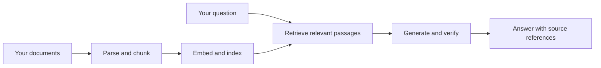

<h1 align="center">Modular RAG Engine</h1>

<p align="center"><strong>Build AI applications that answer questions using your own documents.</strong></p>

<p align="center">
  
  
  
  
  
</p>

<p align="center">
  <a href="#quick-start">Getting Started</a> ·
  <a href="#documentation">Documentation</a> ·
  <a href="docs/api.md">API Reference</a>
</p>

## Overview

Modular RAG Engine is a backend-only application for building document-based AI assistants. It processes your documents, retrieves relevant information, and generates answers with source references through a REST API.

Connect your own frontend, chatbot, or application backend. Choose the supported parsing, embedding, language-model, storage, and queue providers that fit your deployment. Run the Docker stack locally or use the Azure infrastructure templates with Microsoft Foundry.

## Features

- [x] PDF, DOCX, TXT, HTML, and CSV ingestion.
- [x] Background document processing with job-status polling.
- [x] Hybrid keyword and vector retrieval.
- [x] Scoped document access and authenticated API requests.
- [x] Structured evidence selection and source-citation verification.
- [x] Document replacement and deletion through the API.
- [x] Validated answer delivery through JSON or server-sent events.
- [x] Modular providers, Docker services, and Azure deployment templates.

## How It Works



The engine retrieves passages from the requested document scope, asks the configured model to select supporting evidence, and verifies those selections before returning an answer. Source references let your application show the supporting context. These checks constrain provenance; they cannot guarantee that every interpretation is correct.

## Use Cases

| Build | Example |
| --- | --- |
| Employee knowledge assistant | Answer questions about a handbook or internal policy. |
| Customer-support chatbot | Retrieve relevant product guides and support articles. |
| Research assistant | Find and explain information across uploaded reports. |
| Document-search application | Connect a custom interface to scoped retrieval and answers. |

## Example

**Illustrative example — not an actual recorded response.**

> **Document:** Employee Handbook
>
> **Question:** How many days of annual leave do full-time employees receive?
>
> **Answer:** Full-time employees receive 20 days of paid annual leave per year.
>
> **Source:** `employee-handbook.txt` — Annual leave

A fictional [Employee Handbook](examples/employee-handbook.txt) is included for trying your own ingestion and queries. See the [API Reference](docs/api.md) for the actual response schemas and citation fields.

## Quick Start

Install Docker with Compose, then clone the repository:

```bash
git clone https://github.com/rjluteria/Modular-RAG-Engine.git
cd Modular-RAG-Engine
cp .env.example .env.local
```

Edit `.env.local` before starting. Configure your chosen providers, their credentials and endpoints, distinct `API_ADMIN_TOKEN` and `API_USER_TOKEN` values, and the document scopes allowed through `API_USER_USE_CASES`.

The supplied Docker profile uses Qdrant, Redis/RQ, local Sentence Transformers embeddings, and NVIDIA NIM generation. That generation provider requires your own NVIDIA API key. Other supported profiles include Ollama and Azure; see [Configuration](docs/configuration.md) for their requirements. No hosted provider is universally required.

```bash
docker compose -f infra/docker-compose.yml up --build -d
curl http://localhost:8000/api/v1/health
```

Open **[http://localhost:8000/docs](http://localhost:8000/docs)** for interactive API documentation through Swagger UI. Use your admin token to upload a document, poll its job until completion, then query it with an authorized token. The [API Reference](docs/api.md) includes copyable upload, polling, and query examples.

Compose configuration, image builds, local health/authentication checks, and synthetic parser/storage tests are reproducible through the [Testing & Evaluation](docs/evaluation.md) guide. A health response does not verify your selected model credentials or answer quality. First-use embedding weights may need downloading; generation requires a reachable configured provider.

## Documentation

| Guide | What it covers |
| --- | --- |
| [API Reference](docs/api.md) | Authentication, uploads, queries, job polling, streaming, and integration examples. |
| [Configuration](docs/configuration.md) | Provider selection, environment variables, credentials, and examples. |
| [Architecture](docs/architecture.md) | Components, ingestion, retrieval, grounding, and revision publication. |
| [Azure Deployment](docs/azure.md) | Required services, managed identity, templates, and deployment procedures. |
| [Operations](docs/operations.md) | Running, monitoring, maintenance, and troubleshooting. |
| [Testing & Evaluation](docs/evaluation.md) | Automated tests and evaluation of your own documents and deployment. |
| [Security](SECURITY.md) | Authentication, authorization, deployment security, and vulnerability reporting. |
